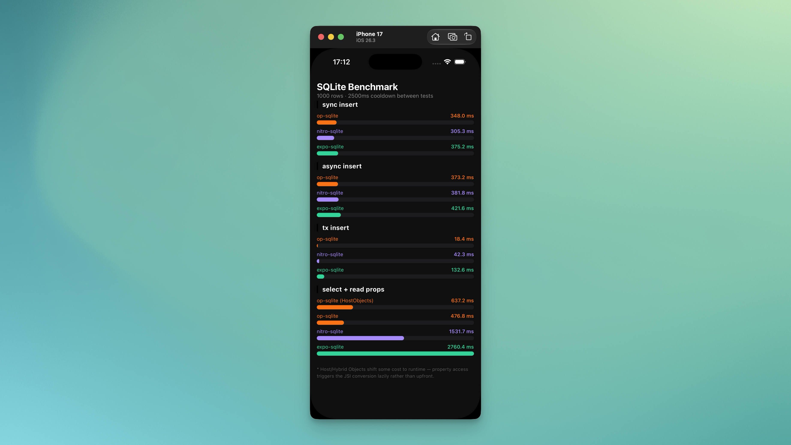

Created by [@ospfranco](https://twitter.com/ospfranco). **Please consider sponsoring!**.

OP-SQLite has grown large to cover a lot of plugins, sqlite versions and APIs. Please read the full documentation before opening an issue.

[Open the docs](https://op-engineering.github.io/op-sqlite/)

Join the Discord:

https://discord.gg/W9XmqCQCKP

Some of the big supported features:

- iOS, Android, macOS and web support
- Vanilla sqlite
- Turso is supported as a compilation target
- Libsql is supported as a compilation target
- SQLCipher is supported as a compilation target
- FTS5 plugin
- Rtree plugin
- sqlite-vec plugin
- Reactive queries
- Custom tokenizers
- Load runtime extensions
- JSONB support
- Native query interruption via `db.interrupt()`

It also contains a simple [Key-Value store](https://op-engineering.github.io/op-sqlite/docs/key_value_storage) you can use without adding one more dependency to your app.

# Custom tokenizers

1. Add `"tokenizers": ["your_tokenizer"]` to the `"op-sqlite"` config in your app's `package.json`.
2. Run `npx react-native config` from your app's folder. It creates `c_sources/tokenizers.h`.
3. Write your implementation in `c_sources/tokenizers.cpp` and commit the `c_sources` folder.

Run the command again whenever you change `"tokenizers"`. See the [tokenizers docs](https://op-engineering.github.io/op-sqlite/docs/tokenizers) for the details.

# License

MIT License.
